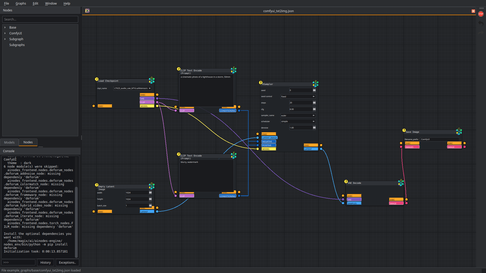
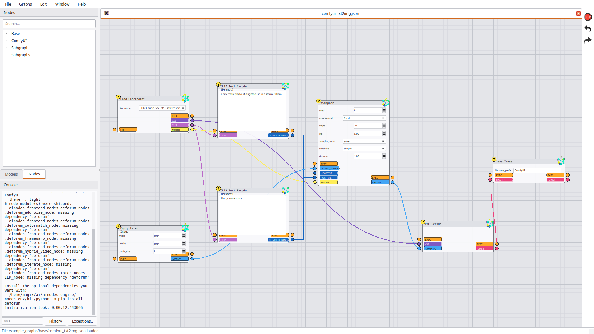
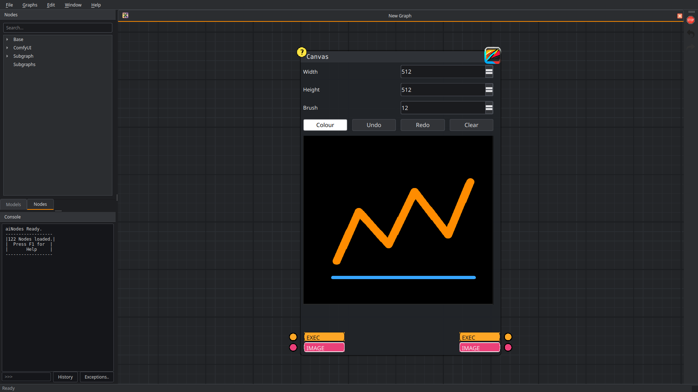

<h1>aiNodes Engine</h1>

<p>aiNodes is a Python/Qt desktop node editor for diffusion models, with a live,
user-declared execution chain, a Python code editor node, and plug-in support.
It borrows a great deal from ComfyUI and other open-source projects - and now it
can borrow their <em>nodes</em> too: point it at a ComfyUI checkout and every node
class ComfyUI has loaded, custom node packs included, shows up as an aiNodes node.</p>

<p align="center">
  
  <br>
  <em>A ComfyUI txt2img graph - Load Checkpoint, CLIP Text Encode, KSampler, VAE Decode, Save Image - built from adapted ComfyUI nodes.</em>
</p>

<p align="center">
  
  <br>
  <em>The same graph in the light theme. Both themes come from one palette, canvas included.</em>
</p>

## 💖 Support the project

Please consider starring, or contributing to the project. Updates are frequent, and
the more time I can spare on the project, the greater things can be implemented.
Thank you for being here!

## 📚 Table of Contents

- [Install](#-install)
- [Running](#-running)
- [ComfyUI interop](#-comfyui-interop)
- [Themes](#-themes)
- [Hardware](#-hardware)
- [Headless](#-headless)
- [What changed in this round](#-what-changed-in-this-round)
- [Contributing](#-contributing)
- [Features](#-features)
- [License](#-license)

<a name="-install"></a>
## 🔧 Install

**Requirements**

- Python 3.11 – 3.14
- Git
- A GPU is optional: NVIDIA (CUDA), AMD (ROCm), Intel (XPU) and Apple silicon
  (MPS) are all handled, and there is a CPU fallback.

**Every platform** uses the same installer:

```shell
git clone https://github.com/XmYx/ainodes-engine
cd ainodes-engine
python3 install.py            # Linux / macOS
```

```bat
git clone https://github.com/XmYx/ainodes-engine
cd ainodes-engine
install.bat                   REM Windows
```

`install.py` detects your GPU, creates `nodes_env/`, and installs the matching
PyTorch wheels. It uses [uv](https://github.com/astral-sh/uv) when it is on PATH
and falls back to pip otherwise. Useful flags:

| flag | what it does |
| --- | --- |
| `--comfy-path /path/to/ComfyUI` | use a ComfyUI you already have |
| `--with-comfy` | clone ComfyUI into `src/ComfyUI` |
| `--comfy-requirements` | also install ComfyUI's own requirements into this environment |
| `--comfy-node-requirements` | also install every ComfyUI custom node pack's requirements |
| `--torch-backend cpu\|cu128\|cu130\|rocm\|xpu\|mps` | force a wheel set instead of detecting |
| `--optional` | install `requirements-optional.txt` too |
| `--system` | install into the current interpreter instead of a venv |

`install.sh` / `install.bat` are thin wrappers around it.

<a name="-running"></a>
## ▶️ Running

```shell
./ainodes.sh                  # Linux / macOS
ainodes.bat                   REM Windows
```

or directly:

```shell
./nodes_env/bin/python main.py
```

`python main.py --help` lists everything. The flags worth knowing:

```
--theme dark|light|system      colour theme
--device cuda|rocm|xpu|mps|cpu  accelerator (default: auto)
--comfy-path PATH              which ComfyUI to borrow nodes from
--no-comfy                     start without ComfyUI nodes
--open GRAPH                   open a graph at startup
--headless --run GRAPH         execute a graph with no window
--screenshot FILE              save a screenshot once the window is up
--report-js-widgets            list widgets custom node packs declare in JS
```

Open **File → Example Graphs** for somewhere to start, and
`example_graphs/base/comfyui_txt2img.json` for the ComfyUI graph in the
screenshots above.

<a name="-comfyui-interop"></a>
## 🧩 ComfyUI interop

aiNodes finds ComfyUI in this order:

1. `--comfy-path`
2. `$AINODES_COMFYUI_PATH` or `$COMFYUI_PATH`
3. `comfyui_path:` in `config/comfy.yaml` (written by `install.py`)
4. `./src/ComfyUI`, then `../ComfyUI`, `~/ComfyUI`, `~/ai/ComfyUI`

Everything in ComfyUI's `NODE_CLASS_MAPPINGS` is then wrapped as an aiNodes node
under the **ComfyUI** category: ports for the data types, real Qt widgets for the
declared inputs, combo boxes for the choice lists, a file picker for
`image_upload` inputs, and a fixed/increment/decrement/randomize control for
`control_after_generate` seeds. Both the classic V1 node layout and the newer V3
schema classes work, async node functions are awaited, and `{"ui": ...}` results
are kept.

Verified here against **ComfyUI 0.44.2**: 1085 node classes adapted, including the
custom node packs installed in that checkout.

**What is not possible, and why.** Some packs add widgets from JavaScript
(`app.registerExtension` + `node.addWidget(...)`) and read them back out of the
browser's `widgets_values`. That information does not exist on the Python side,
so there is nothing to introspect. `ainodes_frontend/comfy_fns/js_widgets.py`
goes as far as statically reading the pack's JavaScript, finding `addWidget` /
`ComfyWidgets` calls and the node name next to them, and offering those as plain
value fields that are passed to the node function when its signature accepts
them. Run `python main.py --report-js-widgets` to see exactly what that finds on
your install - on the one used here it resolved 4 widgets across 2 node classes
and could not attribute 47 others, because they are built dynamically at runtime.
Widgets whose *behaviour* lives in JavaScript (pose editors, image croppers,
custom canvases) are not reimplemented; at best you get the value field.

ComfyUI custom nodes often need third-party packages. Install them into the same
environment the way the console tells you to, or run
`python install.py --comfy-node-requirements` once.

<a name="-themes"></a>
## 🎨 Themes

Dark and light, both built from a single palette in
`ainodes_frontend/base/theme.py`. The palette drives the Qt stylesheet
(`ainodes_frontend/qss/theme.qss.tmpl`) *and* the colours the node canvas paints
with, so switching the theme recolours the graph as well as the window chrome.

Switch with `--theme`, **File → Toggle Light/Dark** (`Ctrl+Shift+T`), or
**File → Theme…**; the choice is remembered. `--theme system` follows the
desktop. A custom `ainodes_frontend/qss/<name>.qss` is appended after the
generated sheet, so you can override single rules without forking the theme.

<p align="center">
  
  <br>
  <em>The Canvas node: draw on the node, send the result downstream as an IMAGE.</em>
</p>

<a name="-hardware"></a>
## 🖥 Hardware

`ainodes_frontend/base/device.py` is the single place that decides where tensors
live. It handles NVIDIA (CUDA), AMD (ROCm - a ROCm torch build still reports its
GPUs through `torch.cuda`, so that path covers both), Intel (XPU), Apple silicon
(MPS) and CPU, and exposes `empty_cache()`, `synchronize()`, `autocast_dtype()`
and `manual_seed_all()` so nothing has to call `torch.cuda.*` directly.

Pick a device with `--device` or `$AINODES_DEVICE`; `--cpu` is shorthand.

> Tested on this machine against an NVIDIA RTX 4090 with CUDA 13.0 and torch
> 2.14. The ROCm, XPU and MPS paths are written to the same API but **have not
> been run on that hardware** - reports welcome.

<a name="-headless"></a>
## 🤖 Headless

```shell
python main.py --headless --run example_graphs/base/comfy_latent_chain.json
```

The node engine is built on `QGraphicsScene`, so a `QApplication` is always
needed; `--headless` selects Qt's `offscreen` platform plugin, which needs no
display server and works over SSH and in containers. The run reports what each
node produced:

```
[headless] loaded example_graphs/base/comfy_latent_chain.json: 2 node(s)
[headless] run finished after 0.1s (0 left)
[headless] results:
  Empty Latent Image: ok -> LATENT=latent(2, 4, 64, 64)
  Upscale Latent: ok -> LATENT=latent(2, 4, 128, 128)
```

`--run-loops N` repeats the run, `--timeout S` gives up.

There is also a smoke test that boots the whole app offscreen, checks the
themes, bootstraps ComfyUI and executes a two-node ComfyUI graph:

```shell
python tests/smoke_test.py
```

<a name="-what-changed-in-this-round"></a>
## 🛠 What changed in this round

**It runs again on current everything.** Python 3.11–3.14, current torch, current
PyQt6/Qt 6. The pins that forced `torch==2.1.1+cu121`, `xformers==0.0.23`, a
Windows-only `stable-fast` wheel and an old numpy are gone, `requirements-linux.txt`
has been folded back into one `requirements.txt`, and the optional heavyweights
moved to `requirements-optional.txt`.

**No more hard dependency on deforum.** `from deforum.generators.comfy_utils import
ensure_comfy` at the top of `main.py` meant the app would not start without
deforum installed (#32). `ainodes_frontend/comfy_fns/comfy_bootstrap.py` does that
job itself, against whatever ComfyUI you point it at.

**A node pack that cannot import no longer takes the app down.** Each node module
is imported on its own; failures are collected and printed with the exact
`pip install` line that would fix them.

**Qt 6 leftovers fixed.** `QFontMetrics.width()`, `Qt.NoPen`/`Qt.white`,
`QFile.ReadOnly`, and the Qt 5 application attributes that Qt 6 dropped are now
either correct or skipped when the running Qt does not have them.

**basicsr is gone.** Four preprocessors only used it for `load_file_from_url`,
and basicsr no longer imports at all on torchvision ≥ 0.17. That function now
lives in `backend_helpers/download_utils.py`.

**Themes that are actually two themes** (#28), including the canvas, the console
and the node content widgets - the prompt boxes that used to render white on
white have explicit colours now.

**Canvas navigation** (#22): arrow keys pan, `+`/`-` zoom, `F` frames the graph,
`Shift+F` frames the selection, clicking the minimap jumps the view there, and a
graph fits itself to the window when you open it.

**A disconnected input says so** (#21): a required port with nothing attached now
marks the node invalid and prints which input is missing, and a run that cannot
start explains why instead of doing nothing.

**Headless / batch execution** (#20).

**An interactive Canvas node** (#12), with node-local undo/redo that no longer
deletes the node, and a bitmap that survives saving the graph.

**One installer for three platforms** (#32), replacing the Miniconda download,
the venv-inside-a-venv, `config/src.txt` cloning and the `.bat` pile.

<a name="-contributing"></a>
## 🤝 Contributing

Contributions are welcome and appreciated. If you find any bugs or issues with
the app, please open an issue or submit a pull request. `python tests/smoke_test.py`
is a quick way to check a change did not break startup.

<a name="-features"></a>
## 🙌 Features

aiNodes is an open-source desktop AI image / motion generator and editor suite,
designed to be flexible, with an Unreal-like execution chain. It supports:

- ComfyUI node interop - every node class your ComfyUI has, custom packs included
- Deforum (with [deforum-studio](https://github.com/XmYx/deforum-studio) installed)
- Stable Diffusion 1.5 / 2.x / XL, and whatever else your ComfyUI can load
- Upscalers, ControlNet, LoRAs, TI embeddings, hypernetworks
- Kandinsky
- Background separation, human matting / masking, compositing
- An interactive Canvas node
- Drag and drop (from Discord too)
- Subgraphs
- Graph saving as metadata in the image file, and loading it back
- A Python code editor / runner node
- Headless execution

This project came to life thanks to many great backend functions borrowed from
ComfyUI and adapted to work in this unique, live, controllable manner with a
strict user-declared execution chain, leading to data values that can be iterated
at different points in time in your pipeline.

<a name="-license"></a>
## 📄 License

This project is licensed under the L-GPL License. See the [LICENSE](LICENSE) file
for details.

<p align="center">
  
  
</p>

<pre><code>Mention on <a href="https://vjun.io/vdmo/node-based-stable-diffusion-toolkits-2i1j">vjun.io</a>
HU Tutorial by <a href="https://youtu.be/QD7aMacE2f4">mp3pintyo</a>
</code></pre>
